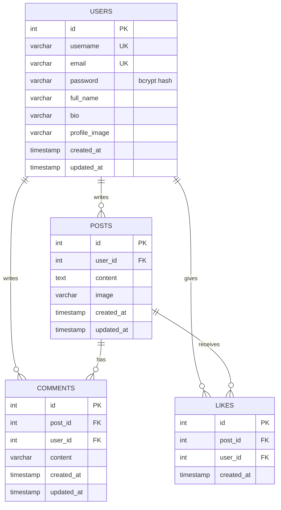

# Entity Relationship Diagram — Sinulid

## Relationships
- One user has many posts, comments and likes. One post has many comments and likes.
- All foreign keys use `ON DELETE CASCADE`: deleting a user removes their content; deleting a post removes its comments and likes.
- `likes` has `UNIQUE (post_id, user_id)`, so one user can like a post only once.
- `users.username` and `users.email` are unique.

## Table notes
| Table | Required by instructor | Extra columns (kept from the original schema) |
|---|---|---|
| users | id, username, password, full_name, bio, profile_image, created_at | email, updated_at |
| posts | id, user_id, content, image, created_at | updated_at (used to show "edited") |
| comments | id, post_id, user_id, content, created_at | updated_at (used to show "edited") |
| likes | id, post_id, user_id | created_at |
